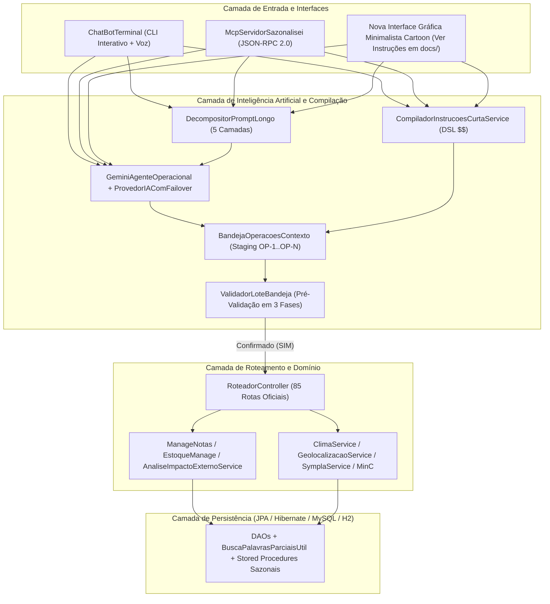

# Documentação Completa do Sistema Sazonalisei — Arquitetura, IA Operacional, Estatística Sazonal Amazônica e Nova Interface Gráfica

> **Status Atualizado (Novembro/2026):**
> - **85 Rotas Homologadas** no [`RoteadorController`](file:///C:/workspace/Java/Sistema%20de%20Vendas/src/main/java/br/com/senac/controller/RoteadorController.java) (`RotaSistema`).
> - **Motor de IA com Decomposição Automática de Prompts Longos** ([`DecompositorPromptLongo`](file:///C:/workspace/Java/Sistema%20de%20Vendas/src/main/java/br/com/senac/integracao/ia/parser/DecompositorPromptLongo.java)) em 5 camadas de dependência.
> - **Validação Estrutural e Relacional em 3 Fases na Bandeja** ([`ValidadorLoteBandeja`](file:///C:/workspace/Java/Sistema%20de%20Vendas/src/main/java/br/com/senac/integracao/ia/validacao/ValidadorLoteBandeja.java), [`ValidadorNota`](file:///C:/workspace/Java/Sistema%20de%20Vendas/src/main/java/br/com/senac/integracao/ia/validacao/ValidadorNota.java), [`ValidadorProduto`](file:///C:/workspace/Java/Sistema%20de%20Vendas/src/main/java/br/com/senac/integracao/ia/validacao/ValidadorProduto.java), [`ValidadorUnidadeMedida`](file:///C:/workspace/Java/Sistema%20de%20Vendas/src/main/java/br/com/senac/integracao/ia/validacao/ValidadorUnidadeMedida.java)).
> - **Suporte a Kits Físicos e Digitais**, resolução flexível por nome/sigla ([`BuscaPalavrasParciaisUtil`](file:///C:/workspace/Java/Sistema%20de%20Vendas/src/main/java/br/com/senac/repository/dao/BuscaPalavrasParciaisUtil.java)) e referências aninhadas `OP-N`.
> - **Limpeza Completa da Interface Antiga em `src/`** e definição do novo padrão visual **Cartoon Simples, Sólido, Macio e Minimalista Amazônico** em [`docs/INSTRUCOES_IA_NOVA_INTERFACE_GRAFICA.md`](file:///C:/workspace/Java/Sistema%20de%20Vendas/docs/INSTRUCOES_IA_NOVA_INTERFACE_GRAFICA.md).

---

## 1. Visão Geral e Arquitetura em Camadas

O **Sazonalisei (`PDV_java_Senac_Poo`)** é um sistema de Ponto de Venda (PDV), Gestão de Estoque FIFO e Inteligência Comercial Sazonal voltado à realidade amazônica, construído em **Java 21**, **Hibernate/JPA + HikariCP**, **H2 (modo MySQL) / MySQL 8.0** e **Jackson JSON**, seguindo rigorosamente os princípios **SOLID**.



---

## 2. Atualizações Recentes do Motor de IA e Bandeja de Contexto

### 2.1. Decompositor Automático de Prompts Longos ([`DecompositorPromptLongo.java`](file:///C:/workspace/Java/Sistema%20de%20Vendas/src/main/java/br/com/senac/integracao/ia/parser/DecompositorPromptLongo.java))
Para evitar perda de contexto em LLMs quando o usuário envia um parágrafo grande com múltiplos cadastros e movimentações (`>= 320` caracteres e `>= 3` cláusulas), o sistema fatia o prompt automaticamente e executa sub-prompts ordenados por dependência:
1. **Camada 1 (`BASE_ESTRUTURAL`)**: Unidades de medida e formas de pagamento.
2. **Camada 2 (`PESSOAS`)**: Fornecedores e clientes (PF/PJ/Simples).
3. **Camada 3 (`PRODUTOS_SIMPLES`)**: Produtos físicos e produtos digitais.
4. **Camada 4 (`KITS_E_VINCULOS`)**: Kits/conjuntos e adição de componentes.
5. **Camada 5 (`NOTAS_E_MOVIMENTACOES`)**: Notas fiscais de compra, venda, devolução e perda.

### 2.2. Validação Estrutural e Relacional em 3 Fases ([`ValidadorLoteBandeja.java`](file:///C:/workspace/Java/Sistema%20de%20Vendas/src/main/java/br/com/senac/integracao/ia/validacao/ValidadorLoteBandeja.java))
Antes de executar qualquer lote da [`BandejaOperacoesContexto`](file:///C:/workspace/Java/Sistema%20de%20Vendas/src/main/java/br/com/senac/integracao/ia/BandejaOperacoesContexto.java):
1. **Validação de Campos e Formato (`Fase 1`)**: [`ValidadorUnidadeMedida`](file:///C:/workspace/Java/Sistema%20de%20Vendas/src/main/java/br/com/senac/integracao/ia/validacao/ValidadorUnidadeMedida.java), [`ValidadorProduto`](file:///C:/workspace/Java/Sistema%20de%20Vendas/src/main/java/br/com/senac/integracao/ia/validacao/ValidadorProduto.java) e [`ValidadorNota`](file:///C:/workspace/Java/Sistema%20de%20Vendas/src/main/java/br/com/senac/integracao/ia/validacao/ValidadorNota.java) verificam parâmetros obrigatórios, limites de tamanho e formatos numéricos.
2. **Simulação Relacional Cumulativa (`Fase 2`)**: O [`ValidadorLoteBandeja`](file:///C:/workspace/Java/Sistema%20de%20Vendas/src/main/java/br/com/senac/integracao/ia/validacao/ValidadorLoteBandeja.java) simula o efeito de cada `OP-1..OP-N` sobre o banco de dados real:
   - Detecta duplicidade de sigla ou nome de Unidade de Medida (ex.: tentar cadastrar `PT = Pacote` quando `Pacote` já existe como `PCT`).
   - Detecta duplicidade de código/nome de Forma de Pagamento e CPF/CNPJ de Pessoas.
   - Propaga falhas em cascata: se `OP-1` (Unidade `PT`) tem conflito, os produtos `OP-7`/`OP-8` que usam `PT`, os componentes do kit `OP-13`/`OP-14` e a nota fiscal `OP-15` são sinalizados preventivamente com a causa raiz exata.
3. **Auditoria Anti-Alucinação e Auto-Correção (`Fase 3`)**:
   - O bloco `[AUDITORIA DE PRÉ-VALIDAÇÃO DA BANDEJA]` é injetado no contexto da IA para que ela jamais afirme que o lote está válido enquanto houver conflito.
   - Quando o usuário responde `"pode corrigir"` (ou similar), [`DecisaoConfirmacao`](file:///C:/workspace/Java/Sistema%20de%20Vendas/src/main/java/br/com/senac/integracao/ia/DecisaoConfirmacao.java) reconhece que é um pedido de ajuste (e não um `"sim"` de execução imediata), permitindo que o [`GeminiAgenteOperacional`](file:///C:/workspace/Java/Sistema%20de%20Vendas/src/main/java/br/com/senac/integracao/gemini/GeminiAgenteOperacional.java) remova a operação redundante e corrija a unidade nos produtos dependentes automaticamente.

### 2.3. Suporte Completo a Kits Digitais/Físicos e Resolução por Nome nas Rotas
- O [`RoteadorController`](file:///C:/workspace/Java/Sistema%20de%20Vendas/src/main/java/br/com/senac/controller/RoteadorController.java) suporta criação de kits tanto físicos quanto digitais (`ehKit=true` em `/produtos/fisico/cadastrar` e `/produtos/digital/cadastrar`) e resolve automaticamente nomes de fornecedores/clientes/produtos caso a IA envie o nome ou `OP-N` em campos de ID (`idFornecedor`, `idCliente`, `idProduto`, `idKit`, `idComponente`).

---

## 3. Fatores Externos Amazônicos, Estatística Sazonal e Geolocalização GPS

1. **Clima e Hidrologia Amazônica ([`ClimaService`](file:///C:/workspace/Java/Sistema%20de%20Vendas/src/main/java/br/com/senac/integracao/clima/ClimaService.java))**:
   - Consulta temperatura máxima, mínima, média, precipitação (`mm`) e vento com cache inteligente de 6 horas para o dia atual e cache mensal para notas históricas.
   - Serve de base tanto para a **triangulação sazonal de notas fiscais** quanto para o **tema de cores dinâmico** da interface gráfica.
2. **Geolocalização GPS e Distância de Eventos ([`GeolocalizacaoService`](file:///C:/workspace/Java/Sistema%20de%20Vendas/src/main/java/br/com/senac/integracao/geolocalizacao/GeolocalizacaoService.java), [`SymplaService`](file:///C:/workspace/Java/Sistema%20de%20Vendas/src/main/java/br/com/senac/integracao/eventos/SymplaService.java), [`MinisterioCulturaService`](file:///C:/workspace/Java/Sistema%20de%20Vendas/src/main/java/br/com/senac/integracao/eventos/MinisterioCulturaService.java))**:
   - Captura a coordenada GPS do dispositivo (`GeoCoordinateWatcher` / fallback IP + Reverse Geocoding OpenStreetMap) e cruza com eventos públicos e privados para calcular a **distância real em quilômetros (fórmula de Haversine)** até a loja.
3. **Estatística Avançada e Padrões Comerciais ([`EstatisticaController`](file:///C:/workspace/Java/Sistema%20de%20Vendas/src/main/java/br/com/senac/controller/EstatisticaController.java) e [`AnaliseImpactoExternoService`](file:///C:/workspace/Java/Sistema%20de%20Vendas/src/main/java/br/com/senac/service/AnaliseImpactoExternoService.java))**:
   - Analisa os **4 padrões fundamentais do comércio**:
     - **Vendas** (demanda por clima, rio, eventos públicos/privados e perfil de consumo do cliente);
     - **Compras** (melhor época climática, ranking de fornecedores e plano estratégico para 15/30/60 dias);
     - **Perdas** (diagnóstico de perda prematura por lote/fornecedor/calor/umidade e ressarcimento);
     - **Devoluções** (motivos pós-venda, impacto no lucro contábil BACEN e estratégia corretiva).

---

## 4. Diretrizes da Nova Interface Gráfica (Resumo Executivo)

Toda a especificação para a IA recriar a interface gráfica encontra-se detalhada em [`docs/INSTRUCOES_IA_NOVA_INTERFACE_GRAFICA.md`](file:///C:/workspace/Java/Sistema%20de%20Vendas/docs/INSTRUCOES_IA_NOVA_INTERFACE_GRAFICA.md):
- **Estética**: Limpa, simples, sólida e macia (**Cartoon Simples / Cozy Claymorphism**), pensada para iniciantes no ramo comercial.
- **Telas Expansíveis**: Resumos diretos no primeiro nível com expansão suave ao clicar (inspirado nas premissas do [`PDV_Sazonal_Python`](file:///C:/workspace/cursoPython/PDV_Sazonal_Python), sem poluição visual).
- **Cores Dinâmicas pelo Clima Amazônico**: Transição automática da paleta conforme o último registro do clima (`Sol Equatorial`, `Chuva Amazônica`, `Brisa da Floresta`, `Friagem`) e estado do rio (`Cheia`, `Normal`, `Seca`).
- **Gráfico Interativo com Fundo Bipartido (Céu/Temperatura no Topo + Rios na Base)**:
  - **Parte Superior do Fundo**: Gradiente dinâmico do Céu segundo a temperatura média e condição climática (Laranja/Vermelho Solar se `> 28,5°C`, Dourado Solar entre `26°C e 28,5°C`, ou Azul Escuro com nuvens carregadas se `< 26°C` / chuvoso).
  - **Parte Inferior do Fundo**: Onda preenchida em azul representando o **Nível do Rio em metros** (`Cheia`, `Normal`, `Seca`).
  - **Curvas Financeiras**: Linhas sobrepostas de **Faturamento de Vendas (`R$`)**, **Lucro Líquido Real (`R$`)** e **Perdas de Estoque (`R$`, quando houver)**.
  - **Dimensões de Tempo e Filtros**: Botões para **`7D (Semana)`**, **`30D (Mês)`**, **`90D (Trimestre)`**, **`Tudo`** e **`Customizar Intervalo (Data Inicial / Final ou Mês)`**, além de filtros combinados por **Rio**, **Clima/Chuva** e **Atalhos Sazonais de Epicentro** (*Pico de Faturamento*, *Baixa no Faturamento*, *Maior Perda de Estoque*, *Época de Cheia do Rio*, *Época de Seca do Rio* e *Semanas Chuvosas*), como no [`PDV_Sazonal_Python`](file:///C:/workspace/cursoPython/PDV_Sazonal_Python/templates/dashboard.html).
- **Mapa GPS de Eventos**: Radar visual mostrando a distância em `km` entre a loja e os eventos públicos/privados locais.
- **Tratamento Total de Dados**: Proibido texto cortado (`...`), letras menores que `15px` ou dados técnicos sem tradução; todos os problemas, alertas e gráficos possuem botão direto para conversar com a IA do ChatBot.

---

## 5. Como Executar os Testes Automatizados

Para compilar o projeto e rodar todas as **7 suítes de testes automatizados** (85 rotas, bandeja de contexto, passo a passo, simulação, parser AST, importador CSV e fluxo de prompt longo + validação em 3 fases):

```powershell
powershell -ExecutionPolicy Bypass -File .\executar_testes.ps1
```
