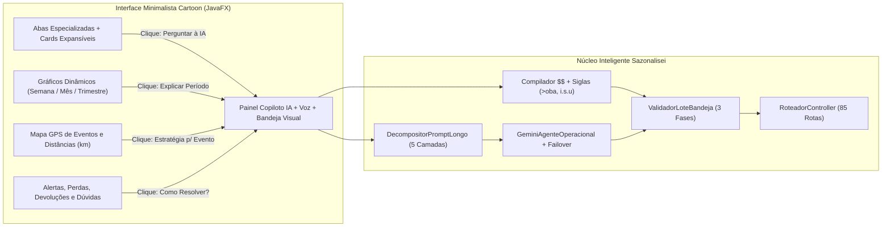

# Guia Mestre e Especificação para a IA: Nova Interface Gráfica Sazonalisei (Estética Cartoon Minimalista, Sólida, Macia e Climática Amazônica)

> **Objetivo deste documento:**  
> Servir como instrução definitiva e completa para qualquer Agente de IA ou desenvolvedor reconstruir do zero a interface gráfica (`br.com.senac.view.javafx`) do **Sazonalisei (PDV Java Senac POO)**.  
> A interface antiga e poluída foi completamente removida de `src/`. A nova interface deve seguir rigorosamente os princípios abaixo, inspirando-se nas **premissas analíticas e sazonais** do projeto [`C:\workspace\cursoPython\PDV_Sazonal_Python`](file:///C:/workspace/cursoPython/PDV_Sazonal_Python) (sem copiar seu layout poluído), priorizando **simplicidade extrema para iniciantes no comércio**, **estética sólida, macia e cartoon simples**, **cores dinâmicas segundo o clima amazônico**, **zero texto cortado ou letra miúda** e **integração total com a IA do ChatBot em cada tela, alerta e problema**.

---

## 1. Filosofia de Design: "Cartoon Simples, Sólido, Macio e Acolhedor" (Cozy Soft-Cartoon UI)

### 1.1. Público-Alvo: Comerciantes Iniciantes
Pessoas que estão entrando agora no ramo comercial sentem-se intimidadas por telas financeiras cheias de tabelas densas, siglas técnicas, códigos de erro e dezenas de botões pequenos. A nova interface deve parecer um **aplicativo amigável, tátil e calmo**:
- **Linguagem Direta de Balcão**: Nunca exibir nomes internos de rotas (`NOTA_VENDA_EMITIR_FIFO`), enums crus (`WRITE_SEGURO`), JSON ou stacktraces. Tudo deve ser traduzido para frases simples e humanas (ex.: *"Venda Rápida no Balcão"*, *"Entrada de Mercadoria"*, *"O lote #14 de Ovos vence em 5 dias"*).
- **Poucos Elementos por Tela (Zero Poluição)**: Máximo de **3 a 4 cards principais** visíveis no primeiro nível. Detalhes extras ficam guardados em **painéis e linhas expansíveis** (Progressive Disclosure), abertos somente quando o usuário clica para expandir.

### 1.2. Regras Visuais do Estilo "Sólido + Macio + Cartoon Simples" (Claymorphism Leve)
Baseado nas melhores práticas de *Cozy Retail UI* e *Soft Cartoon Claymorphism* para JavaFX:
1. **Cantos Generosamente Arredondados**:
   - Cards e painéis principais: `-fx-background-radius: 22px; -fx-border-radius: 22px;`
   - Botões de ação e filtros (formato pílula/bloco macio): `-fx-background-radius: 16px; -fx-border-radius: 16px;`
   - Inputs e caixas de busca: `-fx-background-radius: 14px; -fx-border-radius: 14px;`
2. **Bordas Sólidas Definidas (Traço Cartoon Suave)**:
   - Todo card e botão possui uma borda sólida visível (`-fx-border-width: 2.5px;`) em tom levemente mais escuro ou translúcido que o preenchimento, dando aspecto "sólido e desenhado" sem agressividade.
3. **Sombras Macias Difusas (Efeito Almofadado)**:
   - Sombra suave nos cards: `-fx-effect: dropshadow(three-pass-box, rgba(28, 40, 38, 0.10), 18, 0, 0, 6);`
   - Micro-interação de clique: Ao pressionar um botão, ele desce `2px` (`translateY(2)`) simulando o toque em uma tecla macia de borracha.
4. **Ícones Grandes e Expressivos**:
   - Cada aba, card de resumo, condição climática e alerta deve trazer um ícone vetorial ou emoji grande (`24px` a `32px`) ao lado do título para identificação visual imediata.

---

## 2. Regra Inegociável: Tratamento de Todas as Informações, Zero Estouro e Zero Letra Pequena

> **REGRA DE OURO:** **Nenhuma informação pode ir para a interface sem tratamento prévio.** É terminantemente proibido ocorrer texto cortado com reticências (`...`), sobreposição de componentes, números sem formatação monetária/decimal brasileira ou letras pequenas.

### 2.1. Escala Tipográfica Mínima Obrigatória
- **Fonte recomendada**: `"Nunito"`, `"Quicksand"`, `"Segoe UI Semibold"` ou `"System"` com pesos `600`/`700`.
- **Tamanhos mínimos em toda a aplicação (CSS global)**:
  - **Proibido** qualquer fonte menor que `15px` (`-fx-font-size: 15px;` é o piso absoluto até para legendas e observações).
  - **Texto padrão de tabelas, listas, formulários e balões do Chat IA**: `16px`.
  - **Botões, abas e filtros**: `16px` a `18px` (`font-weight: bold`).
  - **Subtítulos e cabeçalhos de cards**: `20px` a `22px` (`font-weight: bold`).
  - **Valores de destaque (KPIs, Total da Nota, Distância GPS)**: `26px` a `32px` (`font-weight: 800`).

### 2.2. Prevenção Técnica Contra Estouro de Texto em JavaFX (`FormatadorSeguroUI`)
Como o JavaFX não ativa quebra de linha via CSS puro, toda criação de `Label`, célula de tabela ou card **deve** passar por um utilitário central (`FormatadorSeguroUI`):
1. **Quebra Automática e Altura Expansível**:
   ```java
   label.setWrapText(true);
   label.setMinHeight(Region.USE_PREF_SIZE);
   label.setMaxWidth(Double.MAX_VALUE);
   ```
2. **Scroll Suave em Telas Expansíveis**:
   - Toda aba principal deve estar envolvida em um `ScrollPane` com `setFitToWidth(true)` e barras de rolagem discretas, permitindo que os cards expansíveis cresçam livremente na vertical quando abertos, sem espremer outros componentes.
3. **Sanitização e Tradução Obrigatória de Dados (`FormatadorSeguroUI.tratarParaExibicao(...)`)**:
   - Valores monetários (`BigDecimal` / `Double`): sempre `R$ 1.240,50` (com `Locale("pt", "BR")`).
   - Quantidades: sem zeros desnecessários após a vírgula (`12 UN`, `1,5 KG`, `0,750 L`).
   - Datas ISO (`2026-11-15`): convertidas para `15/11/2026 (Hoje)` ou `14/11/2026 (Ontem)`.
   - Valores nulos, vazios ou `"null"`: substituídos por textos claros como `"Não informado"` ou `"Sem registro até o momento"`.
   - Erros técnicos ou validações: lidos de [`config/ia-contexto.properties`](file:///C:/workspace/Java/Sistema%20de%20Vendas/config/ia-contexto.properties) e acompanhados de um botão **"🤖 Pedir ajuda à IA"**.

---

## 3. Cores Dinâmicas Guiadas pelo Clima Amazônico (`ClimaService` + Regime dos Rios)

A interface reflete o ambiente real da Amazônia onde o comércio opera. Ao iniciar (e a cada atualização do [`ClimaService`](file:///C:/workspace/Java/Sistema%20de%20Vendas/src/main/java/br/com/senac/integracao/clima/ClimaService.java) ou do último snapshot climático registrado no banco), o tema visual da janela adapta suas cores de forma suave e acolhedora:

| Estado Climático Amazônico | Gatilho (`ClimaDiario` / Último Registro) | Fundo da Janela (`--bg-app`) | Fundo dos Cards (`--bg-card`) | Borda Sólida Cartoon (`--border-card`) | Cor de Ação Principal (`--accent-main`) | Cor Secundária / Destaque (`--accent-sec`) | Texto Principal (`--text-primary`) |
| :--- | :--- | :---: | :---: | :---: | :---: | :---: | :---: |
| **☀️ Sol Equatorial (Verão Amazônico)** | `temperaturaMedia >= 29.0°C` e `precipitacaoMm < 2.0` | `#FFFDF6` *(Creme Tucumã)* | `#FFFFFF` | `#F6AD55` *(Âmbar Macio 2.5px)* | `#DD6B20` *(Laranja Buriti)* | `#2F855A` *(Verde Floresta)* | `#2D241E` *(Marrom Castanha)* |
| **🌧️ Toró / Chuva Amazônica (Inverno)** | `precipitacaoMm >= 5.0` ou indicador `CHUVOSO` | `#EEF5F9` *(Neblina do Rio)* | `#FFFFFF` | `#63B3ED` *(Azul Igarapé 2.5px)* | `#2B6CB0` *(Azul Rio Negro)* | `#319795` *(Verde-Água)* | `#1A2634` *(Ardósia Escura)* |
| **⛅ Brisa da Floresta (Clima Ameno)** | `24.0°C <= temp < 29.0°C` e chuva leve/moderada | `#F3FAF5` *(Menta Suave)* | `#FFFFFF` | `#68D391` *(Verde Sálvia 2.5px)* | `#2F855A` *(Verde Copaíba)* | `#D69E2E` *(Dourado Sol)* | `#1C2B24` *(Verde Carvão)* |
| **🌬️ Friagem Amazônica** | `temperaturaMedia < 24.0°C` | `#F6F4FB` *(Lavanda Açaí)* | `#FFFFFF` | `#B794F4` *(Lilás Suave 2.5px)* | `#6B46C1` *(Roxo Açaí)* | `#3182CE` *(Azul Céu)* | `#241E38` *(Noite Escura)* |

### 3.1. Barra Climática e Hidrológica no Topo (Header Amazônico)
No topo da janela principal fica uma pílula sólida e macia exibindo em tempo real:
- **Clima Atual**: Ícone grande (`☀️ 31,5°C — Sol Forte em Manaus` ou `🌧️ 25,0°C — Chuva Amazônica (14 mm)`).
- **Regime do Rio**: Indicador visual (`🌊 Rio em Cheia`, `🛶 Nível Normal` ou `🍂 Rio em Vazante/Seca`).
- **Botão Interativo**: Clicar nessa pílula abre um resumo rápido explicando *"Como o clima de hoje afeta suas vendas"* gerado pela IA!

---

## 4. Integração Profunda com a IA do ChatBot (Todos os Problemas Conectados à IA)

O coração do projeto é o ecossistema de IA ([`GeminiAgenteOperacional`](file:///C:/workspace/Java/Sistema%20de%20Vendas/src/main/java/br/com/senac/integracao/gemini/GeminiAgenteOperacional.java), [`BandejaOperacoesContexto`](file:///C:/workspace/Java/Sistema%20de%20Vendas/src/main/java/br/com/senac/integracao/ia/BandejaOperacoesContexto.java), [`CompiladorInstrucoesCurtaService`](file:///C:/workspace/Java/Sistema%20de%20Vendas/src/main/java/br/com/senac/integracao/ia/CompiladorInstrucoesCurtaService.java), [`DecompositorPromptLongo`](file:///C:/workspace/Java/Sistema%20de%20Vendas/src/main/java/br/com/senac/integracao/ia/parser/DecompositorPromptLongo.java) e [`ValidadorLoteBandeja`](file:///C:/workspace/Java/Sistema%20de%20Vendas/src/main/java/br/com/senac/integracao/ia/validacao/ValidadorLoteBandeja.java)). Na nova interface, a IA não fica isolada num canto: **ela conversa com toda a tela**.



### 4.1. Regra "Todo Problema ou Indicador Conecta à IA"
1. **Botão Contextual `"🤖 Perguntar à IA"` em Todos os Cards e Alertas**:
   - Se um produto aparece com **estoque baixo ou próximo do vencimento**, há um botão macio ao lado: `"🤖 Sugerir promoção ou reposição"`.
   - Se uma **perda ou devolução** aparece na estatística, há um botão: `"🤖 Analisar motivo e como evitar"`.
   - Se o usuário erra o preenchimento de um campo ou recebe um bloqueio de negócio (ex.: tentar excluir produto com estoque positivo ou conflito detectado pelo `ValidadorLoteBandeja`), o card de aviso mostra o texto simples e um botão `"🤖 Resolver automaticamente com a IA"`.
2. **Bandeja de Contexto Visual e Amigável (`OP-1`, `OP-2`...)**:
   - Quando o usuário pede algo no Chat (por texto, voz via [`CapturadorVozMicrofone`](file:///C:/workspace/Java/Sistema%20de%20Vendas/src/main/java/br/com/senac/application/terminal/CapturadorVozMicrofone.java) ou comando `$$`), as operações preparadas aparecem como **cards macios expansíveis** na Bandeja Visual.
   - Se o [`ValidadorLoteBandeja`](file:///C:/workspace/Java/Sistema%20de%20Vendas/src/main/java/br/com/senac/integracao/ia/validacao/ValidadorLoteBandeja.java) apontar qualquer conflito ou dependência pendente, o card fica destacado em amarelo/coral macio explicando exatamente o que falta, com botões grandes: **`[ ✔ Confirmar Tudo ]`**, **`[ ✏️ Ajustar ]`** e **`[ 🗑️ Limpar ]`**.
3. **Suporte Transparente a Prompts Longos**:
   - Quando o comerciante cola ou dita um pedido longo (ex.: cadastrar unidades, fornecedor, clientes, produtos, kits e já emitir a nota de compra), o [`DecompositorPromptLongo`](file:///C:/workspace/Java/Sistema%20de%20Vendas/src/main/java/br/com/senac/integracao/ia/parser/DecompositorPromptLongo.java) divide automaticamente em até 5 etapas ordenadas por dependência e mostra uma barra de progresso amigável na tela enquanto preenche a Bandeja.

---

## 5. Estrutura de Telas Expansíveis e Abas Especializadas

Inspirado nas premissas funcionais do [`PDV_Sazonal_Python`](file:///C:/workspace/cursoPython/PDV_Sazonal_Python), mas eliminando toda a poluição de tabelas gigantes, a janela principal usa uma **Barra Lateral Esquerda Macia (6 Abas Claras)** + **Área Central com Cards Expansíveis** + **Copiloto IA Retrátil à Direita**:

### Aba 1: 🏠 Início & Dashboard Interativo Sazonal (Fundo Bipartido: Céu/Temperatura no Topo + Rios na Base)
Inspirado diretamente nas premissas do gráfico orgânico de [`templates/dashboard.html`](file:///C:/workspace/cursoPython/PDV_Sazonal_Python/templates/dashboard.html) do projeto `PDV_Sazonal_Python`, porém redesenhado em estética **Cartoon Sólida, Macia e Despoluída**:

- **Linha Superior (4 Cards Macios Grandes)**:
  1. **👥 Clientes Cadastrados / Ativos** (com indicador de crescimento mensal).
  2. **📦 Produtos e Saúde do Estoque** (quantos itens estão saudáveis vs. atenção de validade).
  3. **💰 Faturamento Total no Período** (com comparativo simples: *"↑ +18% neste período"*).
  4. **📈 Lucro Líquido Real** (Vendas menos custos de estoque FIFO e baixas).

- **Centro: Gráfico Interativo Sazonal com Fundo Dividido em 2 Camadas Naturais (`GraficoSazonalPeriodoCanvas`)**:
  1. **Fundo Bipartido (Céu/Temperatura em Cima + Nível dos Rios em Baixo)**:
     - **Parte Superior (Céu + Temperatura Média do Período)**:
       - Renderiza um gradiente vertical no topo do canvas + brilho radial (*Sun Flare* ou *Cloud Flare*) conforme a temperatura média (`avgTemp`) dos dias filtrados:
         - **Bem Quente (`avgTemp > 28,5°C`)**: Céu em gradiente Laranja/Coral Solar suave (`rgba(239, 68, 68, 0.32)` → `rgba(249, 115, 22, 0.18)`) com foco radial de Sol Forte no canto superior direito.
         - **Ensolarado / Ameno (`26,0°C <= avgTemp <= 28,5°C`)**: Céu em gradiente Amarelo Dourado (`rgba(245, 158, 11, 0.32)` → `rgba(251, 191, 36, 0.16)`) com brilho solar dourado no topo direito.
         - **Chuvoso / Nuvens Carregadas (`avgTemp < 26,0°C` ou `CHUVOSO`)**: Céu em gradiente Azul Noturno/Ardósia (`rgba(30, 58, 138, 0.42)` → `rgba(71, 85, 105, 0.22)`) com foco radial de nuvens de chuva no canto superior esquerdo.
     - **Parte Inferior (Rios — Onda Hidrológica Preenchida na Base)**:
       - Desenha na metade inferior do gráfico (eixo secundário `yRio`, escalado para `max = maiorNivelRio * 2`) uma **curva orgânica preenchida (`fill: true`, `tension: 0.4`)** com gradiente de água azul (`rgba(0, 119, 182, 0.40)` → `rgba(0, 119, 182, 0.65)`), representando visualmente o nível diário do rio em metros (`Cheia`, `Normal` ou `Seca/Vazante`).
  2. **Linhas Financeiras Sobrepostas ao Cenário (Céu + Rio)**:
     - **Linha 1 — Faturamento de Vendas (`R$`)**: Linha contínua **Verde Esmeralda (`#10b981`, espessura `3.5px`)** com pontos circulares brancos de borda verde e leve preenchimento translúcido.
     - **Linha 2 — Lucro Líquido Real (`R$`)**: Linha tracejada **Azul Marinho Escuro (`#0b2545`, `borderDash: [5, 5]`, espessura `3px`)**, refletindo o ganho real descontado o custo FIFO.
     - **Linha 3 — Perdas de Estoque (`R$`) (Exibida automaticamente quando houver perda no intervalo)**: Linha **Vermelho Coral (`#ef4444`, espessura `2.5px`)**, evidenciando os dias em que houve baixa de perda ou avaria.
     - **Proteção contra Outliers (`dynamicMax` pelo Percentil 95)**: Se houver um pico isolado maior que `3x` o percentil 95 (`p95`), limita o teto visual do eixo Y financeiro em `p95 * 1.5` para não achatar as linhas dos demais dias.
     - **Tooltip Flutuante Macio (Fonte `>= 15px`)**: Ao passar o mouse sobre qualquer dia, exibe um balão sólido e legível com: **Data (`dd/MM/yyyy`)**, **Faturamento (`R$`)**, **Lucro Líquido (`R$`)**, **Perdas (`R$`, se houver)**, **Nível do Rio (`m`)** e **Temperatura (`°C`)**.

  3. **Dimensões de Tempo (`7D`, `30D`, `90D`, `Tudo` e `Customizar Intervalo`)**:
     - Botões em pílula macia no canto superior direito do gráfico:
       - **`[ 7D (Semana) ]`**
       - **`[ 30D (Mês) ]`**
       - **`[ 90D (Trimestre) ]`**
       - **`[ Tudo ]`**
       - **`[ 📅 Customizar Intervalo (De: dd/mm/aaaa — Até: dd/mm/aaaa ou Mês Específico) ]`**: Abre dois seletores de data (`DatePicker` amigáveis) ou seletor de Mês/Ano para o comerciante inspecionar qualquer janela personalizada.

  4. **Filtros Combinados e Pílulas de Atalhos Sazonais (Zoom Automático por Epicentro)**:
     - **Seletores Combinados (Dropdowns Macios)**:
       - **📅 Mês**: `Todos os Meses` ou mês específico (`Jan/2026..Dez/2026`).
       - **🌊 Nível do Rio**: `Todos`, `🌊 Época de CHEIA (Nível Alto)`, `🛶 Período NORMAL`, `🍂 Época de SECA (Nível Baixo)`.
       - **🌧️ Clima / Precipitação**: `Todas`, `🌧️ Semanas Chuvosas`, `🌦️ Chuva Moderada`, `☀️ Tempo Seco / Quente`.
     - **Barra de Atalhos Sazonais (Centralização Inteligente por Epicentro)**:
       - Igual à mecânica de epicentro do `PDV_Sazonal_Python`: quando o usuário clica em um atalho sazonal, o gráfico localiza o índice exato (`epicenterIndex`) daquele evento histórico e **centraliza a janela de 7D, 30D ou 90D ao redor daquele dia** (`epicenterIndex - metadeDias` até `epicenterIndex + metadeDias`):
         - **`🟢 Pico de Faturamento`** *(centraliza no dia/mês de maior venda histórica)*
         - **`🟡 Baixa no Faturamento`** *(centraliza no período de menor venda para diagnóstico)*
         - **`🚨 Maior Perda de Estoque`** *(centraliza no dia de maior perda financeira)*
         - **`🌊 Época de Cheia do Rio`** *(centraliza no pico máximo do nível do rio)*
         - **`🍂 Época de Seca do Rio`** *(centraliza no nível mais baixo da vazante)*
         - **`🌧️ Semanas Chuvosas`** *(centraliza nas semanas de maior precipitação e impacto)*
     - **Integração Direta com a IA**: Ao lado dos filtros fica o botão **`"🤖 Explicar este período com a IA"`**, que envia o recorte visível (faturamento, lucro, perdas, temperatura média e nível do rio) para o `GeminiAgenteOperacional` responder em texto simples o que causou aquele resultado e o que fazer!

### Aba 2: 📊 Estatística Avançada, Comportamento Sazonal e Estratégias
Esta aba traduz todo o poder analítico das Stored Procedures ([`EstatisticaController`](file:///C:/workspace/Java/Sistema%20de%20Vendas/src/main/java/br/com/senac/controller/EstatisticaController.java) e [`AnaliseImpactoExternoService`](file:///C:/workspace/Java/Sistema%20de%20Vendas/src/main/java/br/com/senac/service/AnaliseImpactoExternoService.java)) e das premissas do `relatorios_sazonalizei.html` em **4 Blocos Expansíveis e Visuais**:

1. **Bloco A — Perguntas Sazonais Rápidas (1 Clique para Responder com Gráficos + IA)**:
   - Botões grandes em formato de pergunta para quem está começando no comércio:
     - *"🌧️ O que mais vende quando chove forte ou faz calor?"*
     - *"🎉 Como os eventos públicos e privados afetam minhas vendas?"*
     - *"👤 Qual é o perfil de consumo dos meus melhores clientes em cada época?"*
     - *"⚠️ Por que estou perdendo mercadoria ou tendo devoluções?"*
     - *"🛒 O que devo comprar para os próximos 15, 30 ou 60 dias?"*
   - Ao clicar, o gráfico dinâmico da aba se atualiza imediatamente e o Copiloto IA exibe um resumo direto com a recomendação prática.

2. **Bloco B — Análise dos 4 Padrões Comerciais (Venda, Compra, Perda e Devolução — Motivos e Estratégia)**:
   - Apresentado em **4 Cards Sólidos Expansíveis** (clique para abrir os detalhes sem poluir a tela):
     - **🟢 Padrão de Vendas e Perfil de Consumo**: Mostra quais produtos têm maior margem e saída cruzando **Clima (Quente/Ameno/Chuvoso)**, **Rio (Cheia/Normal/Seca)** e **Eventos Sociais (Públicos ou Privados)**, destacando a margem saudável (`18% a 30%`).
     - **🔵 Padrão de Compras e Fornecedores**: Mostra a **melhor época para comprar** cada produto pelo menor custo unitário e qual fornecedor entrega lotes com maior durabilidade no clima amazônico (`rankingFornecedores`).
     - **🔴 Padrão de Perdas e Motivos (`NotaPerda`)**: Lista os produtos que sofreram perdas (validade vencida, avaria por calor/umidade, quebra no transporte fluvial/terrestre), separando **Perda com Ressarcimento do Fornecedor** vs. **Perda Interna**, e trazendo a **Estratégia Recomendada** (ex.: *"Reduzir lote de compra em 20% nas semanas de chuva forte ou cobrar ressarcimento na próxima nota"*).
     - **🟠 Padrão de Devoluções e Motivos (`NotaDevolucao`)**: Mostra a taxa de devolução por produto/fornecedor, os motivos reais registrados pelos clientes e a **Estratégia Comercial** para corrigir o problema.

3. **Bloco C — Notas Registradas com Triangulação Sazonal Expansível**:
   - Lista limpa das notas emitidas. Ao clicar numa linha, ela **se expande suavemente** mostrando:
     - Produtos e lotes FIFO movimentados;
     - Parcelas e status de pagamento;
     - **Selo Sazonal da Emissão**: Como estava o Clima, o Rio e qual Evento Público/Privado ocorria no dia daquela nota.

4. **Bloco D — 🕸️ Grafo em Foco: Mapa Mental de Bolhas Macias (`GrafoFocoMapaMentalCanvas` — Regra dos 7 Nós, Zero Poluição)**:
   - **Proibido o grafo estilo "teia de aranha" (Obsidian poluído)** que joga todos os registros do banco ao mesmo tempo na tela.
   - Em vez disso, utiliza um **Grafo Radial em Foco (Mapa Mental Guiado)** com **limite rígido de 1 bolha central + no máximo 6 bolhas ao redor** (todas grandes, sólidas, macias, com fonte `>= 16px` e ícones claros). Ao clicar numa bolha periférica, ela desliza suavemente para o centro ou abre a recomendação da IA.
   - **Os 4 Modos de Visão Limpa do Grafo (Seletor em Pílulas)**:
     1. **🌦️ Modo 1: Causa e Efeito Sazonal (`Clima / Rio / Evento` $\rightarrow$ `Top 5 Produtos`)**:
        - Alimentado por [`AnaliseImpactoExternoService`](file:///C:/workspace/Java/Sistema%20de%20Vendas/src/main/java/br/com/senac/service/AnaliseImpactoExternoService.java) e [`EstatisticaController`](file:///C:/workspace/Java/Sistema%20de%20Vendas/src/main/java/br/com/senac/controller/EstatisticaController.java).
        - **Centro**: O cenário climático/sazonal selecionado (ex.: `🌧️ Chuva Forte + 🌊 Cheia do Rio` ou `🎪 Festival Local`).
        - **Ao Redor**: Até 5 bolhas grandes dos produtos mais impactados — **Verdes** para os que disparam em vendas (`+35%`) e **Coral** para os que sofrem risco de perda/umidade, cada uma com botão **"🤖 O que fazer com este item?"**.
     2. **📦 Modo 2: Árvore do Produto, Kit e Embalagens (3 Níveis)**:
        - Alimentado por [`ConjuntoProduto`](file:///C:/workspace/Java/Sistema%20de%20Vendas/src/main/java/br/com/senac/repository/modal/produto/ConjuntoProduto.java) e [`EstoqueManage`](file:///C:/workspace/Java/Sistema%20de%20Vendas/src/main/java/br/com/senac/service/EstoqueManage.java).
        - Mostra em 3 a 4 blocos macios conectados por setas grossas a equivalência física e composição sem confundir o iniciante:
          `Caixa (5 CX)` $\longrightarrow$ `Cartela (60 CART)` $\longrightarrow$ `Unidade (1.800 Ovos)` $\longrightarrow$ `Compõe o "Kit Café da Manhã" (Custo FIFO: R$ 28,50)`.
     3. **🔍 Modo 3: Raio-X 360º de 1 Clique (Espelho Visual da Busca em Cascata `>>`)**:
        - O usuário escolhe **1 Produto**, **1 Cliente** ou **1 Fornecedor** (por nome ou sigla `>oba`, `>isu`).
        - **Centro**: O item pesquisado.
        - **Ao Redor (4 bolhas fixas e organizadas)**:
          - `🚚 Fornecedor & Ressarcimentos`
          - `🏬 Lotes FIFO & Validade`
          - `👥 Principais Compradores`
          - `🌤️ Clima/Evento de Pico`
     4. **⚠️ Modo 4: Rastreio de Perdas e Devoluções (Diagnóstico Visual)**:
        - Alimentado por `ESTATISTICA_MOTIVOS_PERDA_PREMATURA` e `RELATORIO_PERDAS_FORNECEDOR_BACEN`.
        - **Centro**: O Produto que teve perda ou devolução.
        - **Ao Redor (3 bolhas diretas)**: `Fornecedor / Lote de Origem` + `Fator Climático/Transporte Causador` + Botão de Ação **`"🤖 Gerar Abatimento de Ressarcimento com a IA"`**.

### Aba 3: 🗺️ Mapa GPS de Eventos Regionais e Distâncias (Motor Nativo SlippyMap + Tiles CartoDB Voyager / OpenStreetMap)
Conectada diretamente ao [`GeolocalizacaoService`](file:///C:/workspace/Java/Sistema%20de%20Vendas/src/main/java/br/com/senac/integracao/geolocalizacao/GeolocalizacaoService.java), [`SymplaService`](file:///C:/workspace/Java/Sistema%20de%20Vendas/src/main/java/br/com/senac/integracao/eventos/SymplaService.java) e [`MinisterioCulturaService`](file:///C:/workspace/Java/Sistema%20de%20Vendas/src/main/java/br/com/senac/integracao/eventos/MinisterioCulturaService.java):

- **Por que usar o Motor Nativo SlippyMap JavaFX em vez do Gluon Maps puro?**
  - O `com.gluonhq:maps` padrão envia um `User-Agent` antigo bloqueado pelo servidor oficial do OpenStreetMap (`HTTP 403`) e exige módulos externos extras.
  - A estratégia recomendada e 100% compatível com o JDK 21 usa o próprio `HttpClient` do Java (`User-Agent: SazonaliseiPDV/1.0`) para baixar os blocos reais (`256x256` Web Mercator `z/x/y.png`) do **CartoDB Voyager** (`https://basemaps.cartocdn.com/rastertiles/voyager/{z}/{x}/{y}.png` — mapa real de ruas, avenidas e rios com estética pastel macia estilo cartoon) ou **OpenStreetMap**, salvando cache automático em `storage/map_tiles/` e oferecendo fallback instantâneo para o **Modo Radar Cartoon Offline** caso o computador esteja sem internet!

- **Geocodificação Automática dos Eventos Mais Próximos (`GeolocalizacaoService.resolverCoordenadaEvento`)**:
  1. **Posição GPS da Loja**: Obtida via `GeolocalizacaoService.obterCoordenadaLojaAtiva()` (sensor GPS do Windows -> fallback por IP -> coordenada configurada na aba de Ambiente).
  2. **Resolução dos Locais de Eventos**: Cada evento vindo do `SymplaService`, `MinisterioCulturaService` ou `ESTATISTICA_EVENTOS_PERSISTIDOS` passa por `resolverCoordenadaEvento(nome, local, coordLoja)`, que cruza marcos conhecidos de Manaus/Amazônia (*Arena da Amazônia*, *Vasco Vasques*, *Largo de São Sebastião*, *Ponta Negra*, *Studio 5*, *Chapada*, *Adrianópolis*, *Vieiralves*, *Parque Dez*, *Porto*, etc.) e consulta o `Nominatim OpenStreetMap` (`https://nominatim.openstreetmap.org/search`) com cache local.
  3. **Cálculo Exato de Distância (`Coordenada.calcularDistanciaKm` — Fórmula de Haversine)**:
     - Calcula a distância em quilômetros (`km`) entre o GPS da loja e cada evento, ordenando a lista e os pins do **mais próximo para o mais distante**.

- **Recursos Interativos do Mapa na Tela (`MapaGpsEventosCanvas`)**:
  - **Controles de Navegação e Filtro de Raio**:
    - Arrastar com o mouse (Pan) e Zoom (`+` / `–` / roda do mouse entre níveis `11` e `16`), botão **`[ 📍 Centralizar na Minha Loja ]`** e alternador **`[ 🗺️ Mapa de Ruas Pastel | 🎯 Radar Cartoon ]`**.
    - Filtro de proximidade em pílulas: **`[ Todos ]`**, **`[ 🔥 Até 2 km (Vizinhança) ]`**, **`[ 📍 Até 5 km (Bairro/Zona) ]`**, **`[ 🏙️ Até 15 km (Cidade) ]`**.
  - **Pins Cartoon Sólidos e Linha de Distância**:
    - Desenha o **Pin da Loja (`🏪 SUA LOJA`)** com anéis suaves de raio (`2 km`, `5 km`, `15 km`) e traça uma linha pontilhada até o evento selecionado mostrando a distância no meio da linha (`ex.: 1,3 km`).
  - **Integração com a IA em 1 Clique**:
    - Ao clicar em qualquer Pin de evento no mapa (ou no card expansível lateral), exibe: Nome do Evento, Tipo (*Público* ou *Privado*), Local, Data, Distância exata em `km`, Clima Previsto e o botão **`"🤖 Qual estratégia e estoque preparar para este evento?"`**, que envia os dados completos do evento e da distância para o ChatBot IA responder na hora!

### Aba 4: 🛒 Balcão & Notas (Vendas, Compras, Devoluções e Perdas Simples)
- **Modo Passo a Passo para Iniciantes**:
  - Botões grandes no topo para escolher a operação: **`[ 🟢 Vender no Balcão ]`**, **`[ 🔵 Registrar Compra ]`**, **`[ 🟠 Registrar Devolução ]`**, **`[ 🔴 Baixar Perda ]`**.
  - Busca instantânea que aceita nome parcial ou sigla (`>oba`, `o.b.a`, `i.s.u`) via [`BuscaPalavrasParciaisUtil`](file:///C:/workspace/Java/Sistema%20de%20Vendas/src/main/java/br/com/senac/repository/dao/BuscaPalavrasParciaisUtil.java).
  - Botões `+` e `–` grandes e arredondados para ajustar quantidades sem precisar digitar tudo.
  - Cálculo automático de subtotal, sugestão de preço de venda e abatimento de perdas do fornecedor (ressarcimento).

### Aba 5: 📦 Produtos, Kits, Estoque FIFO & Pessoas
- Unifica de forma limpa e organizada por sub-abas expansíveis:
  - **Catálogo de Produtos e Kits Compostos**: Cards visuais com foto, preço, unidade de medida e saldo total (mostrando equivalência clara: ex. *"5 Caixas = 60 Cartelas = 1.800 Unidades"*).
  - **Fila de Estoque FIFO com Semáforo Amigável**:
    - 🟢 **Em Dia** (validade longa)
    - 🟡 **Atenção** (vence em menos de 15 dias — botão *"🤖 Criar promoção com IA"*)
    - 🔴 **Crítico / Vencido** (botão *"🤖 Baixar perda e cobrar fornecedor"*)
  - **Clientes, Fornecedores e Contas (Pagamentos)**: Fichas simples expansíveis mostrando contatos, limite de crédito e parcelas a receber/pagar com quitação em 1 clique.

### Aba 6: ⚙️ Configuração de Ambiente e Personalização Amazônica
Uma aba dedicada, limpa e amigável para configurar todo o ambiente de operação:
1. **Localização GPS e Clima Amazônico**:
   - Botão **"📍 Detectar Meu GPS Agora"** (`GeolocalizacaoService`) ou seleção manual de Cidade/Bairro na Amazônia (Manaus, Parintins, Itacoatiara, Manacapuru, Tefé, Belém, Santarém, etc.) e Bacia Hidrográfica (Rio Negro, Rio Solimões, Rio Amazonas, Rio Madeira, Rio Tapajós).
   - Escolha do modo de cores: **Dinâmico pelo Último Clima (Recomendado)** ou fixar um tema amazônico (Sol Equatorial, Chuva Amazônica, Brisa da Floresta).
2. **Assistente de IA e Voz**:
   - Escolha do provedor principal e failover (`Gemini`, `OpenAI Compatível`, `Local`), personalidade do assistente (ex.: *"Consultor Comercial Calmo para Iniciantes"*) e teste do microfone (`CapturadorVozMicrofone`).
3. **Acessibilidade e Conforto Visual**:
   - Controle deslizante de **Tamanho das Letras**: *Normal (16px)*, *Grande (18px)* ou *Extra Grande de Balcão (20px)*.
4. **Gestão de Dados e Importação CSV**:
   - Importação guiada de planilhas CSV (`ImportadorCsvService`) e botão protegido de reinicialização da base de demonstração.

---

## 6. Arquitetura Técnica Recomendada para Quando a IA For Gerar o Código

Quando solicitado a implementar o código JavaFX a partir desta documentação, a IA deve organizar os arquivos sob `src/main/java/br/com/senac/view/javafx/` respeitando **SOLID**, **baixo acoplamento** e **alta coesão**:

```text
src/main/java/br/com/senac/view/javafx/
├── SazonaliseiGuiApp.java                  # Application JavaFX com tema dinâmico climático e layout expansível
├── SazonaliseiGuiLauncher.java             # Launcher compatível com JDK 21 classpath
├── tema/
│   ├── GerenciadorTemaClimatico.java       # Lê ClimaDiario/Rio e aplica variáveis de cor Amazônicas em tempo real
│   └── FormatadorSeguroUI.java             # Garante wrapText=true, fontes >= 15px, formatação BR e zero texto cortado
├── ponte/
│   ├── PonteRoteadorIA.java                # Conecta todas as 85 rotas, Bandeja, Decompositor e ValidadorLoteBandeja em Virtual Threads
│   └── ConectorProblemasIA.java            # Transforma qualquer alerta/erro/dúvida da tela em consulta contextual para a IA
├── componentes/
│   ├── CardMacioExpansivel.java            # Componente base Cartoon/Claymorphism com resumo + gaveta expansível
│   ├── GraficoSazonalPeriodoCanvas.java    # Gráfico dinâmico bipartido (Céu/Temp + Rio) com filtro 7D/30D/90D/Custom e Epicentro
│   ├── GrafoFocoMapaMentalCanvas.java      # Mapa mental limpo de bolhas macias (máx. 7 nós: Sazonal, Kit 3 níveis, Raio-X 360º e Perdas)
│   ├── MapaGpsEventosCanvas.java           # Radar/Mapa GPS com cálculo Haversine (km) para eventos públicos e privados
│   └── PainelCopilotoIAChat.java           # Chat IA + Microfone + Cards interativos da Bandeja de Contexto
└── abas/
    ├── AbaInicioClimaView.java             # KPIs + Gráfico Semana/Mês/Trimestre + Insights Climáticos
    ├── AbaEstatisticaAvancadaView.java     # Perguntas Sazonais + 4 Padrões (Venda, Compra, Perda, Devolução) + Estratégias
    ├── AbaMapaEventosGpsView.java          # Mapa GPS de eventos locais, distâncias e preparação de estoque
    ├── AbaBalcaoNotasView.java             # Emissão fácil de Venda, Compra, Devolução e Perda
    ├── AbaCatalogoEstoquePessoasView.java  # Produtos, Kits, Fila FIFO e Clientes/Fornecedores/Pagamentos
    └── AbaConfiguracaoAmbienteView.java    # Configuração de GPS, Clima/Rio, IA, Tamanho de Fonte e CSV
```

### Checklist de Qualidade Obrigatório para a IA Antes de Entregar a Interface
- [ ] **Nenhum texto cortado (`...`)**: Todos os `Label` possuem `setWrapText(true)` e `setMinHeight(Region.USE_PREF_SIZE)`.
- [ ] **Nenhuma letra pequena**: Todas as regras de estilo usam `-fx-font-size >= 15px`.
- [ ] **Nenhum dado cru**: Nenhuma tela exibe `null`, JSON, códigos internos de rota ou exceções Java sem tradução amigável.
- [ ] **Cores dinâmicas funcionando**: A cor de fundo e destaque muda automaticamente conforme o último registro de clima (`Sol`, `Chuva`, `Ameno`, `Friagem`) e regime do rio.
- [ ] **Gráfico com filtro Semana, Mês e Trimestre**: Os botões `Semana`, `Mês` e `Trimestre` recalculam e redesenham imediatamente as curvas de Vendas, Lucro, Perdas e Clima/Rio.
- [ ] **Mapa GPS com distância em km**: Calcula a distância real via fórmula de Haversine entre a coordenada do `GeolocalizacaoService` e os eventos públicos/privados.
- [ ] **4 Padrões analisados (Venda, Compra, Perda, Devolução)**: Mostra causas, motivos e estratégias acionáveis.
- [ ] **100% conectado à IA**: Todo card de problema, gráfico, evento ou validação possui botão direto para conversar ou resolver com a IA via `GeminiAgenteOperacional` e `BandejaOperacoesContexto`.
