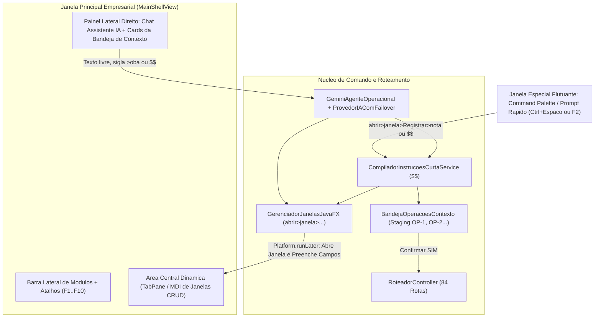

# Relatório de Mapeamento, Testes Complexos `$$` (CRUD / Rotas / Buscas / Erros em `.properties`) e Arquitetura JavaFX Nível Empresarial

> **Objetivo deste documento (Planejamento para a Próxima Rodada):**  
> Consolidar em um único plano técnico e textual:
> 1. **Bateria de Testes Complexos `$$`** para cada CRUD (`C=`, `R=`, `U=`, `D=`) cobrindo todas as classes de domínio.
> 2. **Análise das 84 Rotas (`RotaSistema`) e das Buscas Indexadas/Siglas (`BuscaPalavrasParciaisUtil`)**, validando o comportamento esperado de cada fluxo.
> 3. **Mapeamento e Padronização de Tratamento de Erros via `.properties` (`ia-contexto.properties` / `erros-sistema.properties`)**, garantindo que nenhuma mensagem de erro fique hardcoded no código.
> 4. **Arquitetura e Mapeamento Completo da Interface Gráfica JavaFX Nível Empresarial**, incluindo configuração de ambiente, catálogo de janelas, integração dupla de prompt (**Chat Lateral** + **Janela Especial / Command Palette**) e suporte ao comando de navegação e pré-preenchimento `abrir>janela>Registrar>nota` (tanto digitado pelo operador quanto disparado automaticamente pela IA ao preparar um registro).

---

## 1. Bateria de Testes Complexos `$$` por CRUD (Todas as Classes de Domínio)

Abaixo estão os cenários complexos encadeados (`;`) em sintaxe `$$` planejados para homologar cada módulo na suíte automatizada, validando **Consultas Paralelas em Virtual Threads (`R=`)** sem fechar a bandeja e **Estágio Transacional na `BandejaOperacoesContexto` (`C=`, `U=`, `D=`)**.

### 1.1. Módulo Produto (`Um`, `Produto`, `ProdutoFisico`, `ProdutoDigital`, `ConjuntoProduto`, `Componente`, `ImagemProduto`)

```text
# 1. Criação em lote + Kit composto + Consulta paralela (R= não fecha a bandeja!)
$$ C= #Um nm> CX, desc> Caixa com 12 Unidades, val> 12.000000;
   C= #ProdutoFisico, nm> Ovos Caipira Vermelho, um> CX, vv> 32.90, dim> 30x25x15, pb> 1.800, pl> 1.650;
   C= #ProdutoDigital, nm> Ebook Receitas da Granja, vv> 19.90, desc> Link PDF vitalicio;
   C= #ConjuntoProduto, nm> Combo Cafe da Manha Caipira, vv> 45.00, ++ #Componente[ ++ nm> >ocv, q> 1; ++ nm> >erdg, q> 1 ];
   R= #Produto nm> >ocv;

# 2. Atualização cirúrgica em memória (OP-2) e atualização de catálogo (preço, nome e dimensões)
$$ U= id> OP-2, vv> 34.50;
   U= #Produto, nm> >ocv, novo_nm> Ovos Caipira Vermelho Extra, vv> 36.00, dim> 32x25x15, pb> 1.900, pl> 1.750;
   U= #Um, nm> CX, desc> Caixa Reforcada 12 UN, val> 12.000000;

# 3. Exclusão com validação de estoque (bloqueio preventivo vs baixa de perda isenta em cascata)
$$ D= #Produto, nm> >ocve;
$$ D= #Produto, nm> >ocve, -- #NotaPerda[ q> total, resp> isento, mot> Abatimento para descontinuar item ];
   D= #Um, nm> CX;
```

### 1.2. Módulo Pessoa e Documentos (`Pessoa`, `PessoaFisica`, `PessoaJuridica`, `Registro`)

```text
# 1. Cadastro completo de Cliente PF, Fornecedor PJ, Pessoa Simples e Documentos Auxiliares (IE, RG, CNH)
$$ C= #PessoaFisica, nm> Igor da Silva Uchoa, tp> CLIENTE, doc> 123.456.789-00, val> 5000.00;
   C= #PessoaJuridica, nm> Granja Marinho Agropecuaria, tp> FORNECEDOR, doc> 12.345.678/0001-99, val> 25000.00;
   C= #Pessoa, nm> Carlos Eduardo Mendes, tp> AMBOS, val> 3500.00;
   C= #Registro, pes> >isu, tp> RG, doc> 2849102-SSP;
   C= #Registro, pes> >gma, tp> IE, doc> 04.192.837-1;

# 2. Consultas simultâneas por sigla (>isu, i.s.u), por documento único e Histórico 360º
$$ R= #Pessoa nm> >isu;
   R= #Pessoa nm> i.s.u;
   R= #Registro tp> IE, doc> 04.192.837-1;

# 3. Atualização de limite de crédito e razão social + Exclusão
$$ U= #Pessoa, nm> >isu, novo_nm> Igor da Silva Uchoa Neto, val> 8500.00;
   D= #Pessoa, nm> Carlos Eduardo Mendes;
```

### 1.3. Módulo Pagamento e Títulos Financeiros (`FormaPagamento`, `PagamentoAVista`, `PagamentoAPrazo`, `PagamentoParcelado`, `NotaPagamento`, `ParcelaPagamento`)

```text
# 1. Cadastro de Forma de Pagamento customizada + Títulos à vista, a prazo e parcelados (BACEN HALF_EVEN)
$$ C= #FormaPagamento, cod> PIX_EMPRESARIAL, nm> Pix Empresarial Instantaneo, desc> Taxa zero liquidacao imediata;
   C= #PagamentoAVista, nm> PIX, val> 450.00, dt> hoje;
   C= #PagamentoAPrazo, nm> BOLETO, val> 1200.00, dt> 30>;
   C= #PagamentoParcelado, nm> CARTAO_CREDITO, val> 900.00, q> 3, dt> 30>;
   R= #FormaPagamento;

# 2. Baixa e quitação de títulos/parcelas de notas + Exclusão de forma de pagamento
$$ U= #NotaPagamento, notas> 1-2, ++ #Baixa[ ++ pix, 600.00, hoje; ++ dinheiro, 600.00, ontem ];
   D= #FormaPagamento, cod> PIX_EMPRESARIAL;
```

### 1.4. Módulo Notas Operacionais e Estoque FIFO (`NotaCompra`, `NotaVenda`, `NotaDevolucao`, `NotaPerda`, `Estoque`, `Item`)

```text
# 1. Emissão de Nota de Compra complexa com múltiplos produtos, ressarcimento de perda do fornecedor e pagamentos escalonados
$$ C= #NotaCompra, nm> Granja Marinho, dt> <4,
     ++ #Produto[ ++ nm> >oba, vc> 12.50, q> 100; ++ nm> >ocv, vc> 22.00, q> 50 ]
     ++ #Ressarcimento[ ++ perdido> >oba, q_perd> 5, vc_perd> 12.50, recebido> >oba, q_rec> 5, vc_rec> 12.50 ]
     ++ #Pagamento[ ++ dinheiro, 1000.00, dt> <3; ++ pix, 675.00, hoje; ++ boleto, 675.00, 15> ];

# 2. Emissão de Nota de Venda (FIFO, Balcão e Lote Desejável) + Consulta paralela de saldo de estoque
$$ R= #Estoque, nm> >oba;
   C= #NotaVenda, tp> FIFO, nm> >isu, dt> hoje,
     ++ #Produto[ ++ nm> >oba, vv> 18.50, q> 10 ]
     ++ #Pagamento[ ++ pix, 185.00, hoje ];
   C= #NotaVenda, tp> BALCAO, dt> hoje,
     ++ #Produto[ ++ nm> >oba, vv> 18.50, q> 2 ]
     ++ #Pagamento[ ++ dinheiro, 37.00, hoje ];

# 3. Registro de Nota de Devolução (com e sem responsabilidade do fornecedor) e Nota de Perda direta em Lote
$$ C= #NotaDevolucao, id_venda> 1, resp> forn, mot> Embalagem avariada no transporte,
     ++ #Produto[ ++ nm> >oba, q> 2 ];
   C= #NotaPerda, id> 1, q> 3, resp> isento, mot> Quebra interna na reposicao de gondola;
   R= #Nota;
```

---

## 2. Análise Completa das Rotas (`RotaSistema`) e Motor de Buscas (`BuscaPalavrasParciaisUtil`)

### 2.1. Matriz de Cobertura das 84 Rotas e Governança de Concorrência

| Módulo | Total de Rotas | Classificação de Risco | Comportamento na Bandeja e Virtual Threads |
| :--- | :---: | :--- | :--- |
| **`SISTEMA`** | 2 | `READ_ONLY` / `WRITE_SEGURO` | `BUSCA_PADRAO_IA` roda livre em Virtual Thread; carga inicial protege duplicidade. |
| **`PRODUTO`** | 22 | `READ_ONLY` (7) / `WRITE_SEGURO` (12) / `DESTRUTIVO` (3) | Consultas (`listar`, `buscar`, `estoque-valido`) livres em paralelo; cadastros/edições/exclusões retidos na `BandejaOperacoesContexto`. |
| **`PESSOA`** | 16 | `READ_ONLY` (7) / `WRITE_SEGURO` (8) / `DESTRUTIVO` (1) | Buscas por nome, sigla (`>isu`, `i.s.u`), documento único e histórico 360º livres em Virtual Thread; mutações retidas na Bandeja. |
| **`PAGAMENTO`** | 9 | `READ_ONLY` (1) / `WRITE_SEGURO` (7) / `DESTRUTIVO` (1) | Listagem de formas ativas em paralelo; criação de títulos e quitações retidas na Bandeja com validação BACEN (`HALF_EVEN`). |
| **`ESTOQUE`** | 7 | `READ_ONLY` (6) / `WRITE_SEGURO` (1) | Saldo consolidado, fila FIFO e validade rodam em Virtual Threads sem travar a Bandeja; baixa de perda direta retida para confirmação. |
| **`NOTA`** | 12 | `READ_ONLY` (3) / `WRITE_SEGURO` (9) | Emissão de Compra, Venda FIFO, Venda Balcão, Venda Lote e Devolução retidas na Bandeja com trava por recurso no commit. |
| **`RELATORIO`** | 3 | `READ_ONLY` (3) | Views contábeis BACEN (`vw_apuracao_lucro_contabil`, `vw_perdas_por_fornecedor`, `vw_analise_sazonal_vendas`) em Virtual Threads. |
| **`ESTATISTICA`** | 11 | `READ_ONLY` (10) / `WRITE_SEGURO` (1) | Stored Procedures de previsão de demanda, perfil de cliente, impacto dos rios/clima e plano de compras em Virtual Threads. |
| **`FATOR_EXTERNO`** | 3 | `READ_ONLY` (2) / `WRITE_SEGURO` (1) | Eventos Sympla/MinC, resolução em janela de 6h e relatório integrado citando cada Nota. |

### 2.2. Regras Homologadas do Motor de Busca (`BuscaPalavrasParciaisUtil`)

1. **Busca por Sigla Explícita (Dentro e Fora de `$$`)**:
   - **Com seta (`>`)**: `>oba`, `>otba`, `>isu`, `>gma`
   - **Com pontos (`.`)**: `o.b.a`, `o.t.b.a`, `i.s.u`, `g.m.a`
   - **Separada por espaços**: `o b a`, `i s u`
   - **Em frases naturais fora de `$$`**: `"procura produto o.b.a"`, `"buscar >oba"`, `"cliente i.s.u"` (interceptadas em Virtual Thread sem fechar a Bandeja!).
2. **Tolerância a Preposições e Ordem de Iniciais**:
   - Ignora automaticamente preposições de ligação (`de`, `da`, `do`, `das`, `dos`, `e`, `em`, `com`, `para`, `por`, `tipo`, `un`, `kg`, `lt`, `mt`), permitindo que `>isu` e `i.s.u` encontrem `"Igor da Silva Uchoa"` com pontuação máxima (`920`) e que `>oba` ou `>otba` encontrem `"Ovos Branco Tipo A Especial"`.
3. **Desempate Interativo**:
   - Quando mais de um registro empata na pontuação da sigla, o sistema não escolhe às cegas: exibe a lista enxuta dos candidatos empatados perguntando ao usuário qual deles deseja utilizar.

---

## 2.3. Retornos do ChatBot para Busca em Sequência (`;`) e Busca em Cascata (`>>`)

Além do retorno simples de uma linha, o ChatBot e o compilador `$$` suportarão **dois modos avançados de consulta paralela em Virtual Threads** para **Nota, Produto, Fornecedor, Cliente, Pessoa, Contatos e Pagamentos**:

- **Operador de Sequência (`;`)**: Executa múltiplas buscas independentes em paralelo e exibe os blocos na ordem solicitada.
- **Operador de Cascata (`>>` ou `cascata> total`)**: Navega pelas relações da entidade principal (`1:N` e `N:1`) e monta uma **árvore relacional completa** sem poluição visual.

---

### A) Retorno em Cascata para `Cliente` / `Pessoa` (`#Cliente`, `#Pessoa` >> `#Contato` >> `#Nota` >> `#Produto` >> `#Pagamento`)

**Comando do Usuário (em `$$` ou linguagem natural):**
```text
$$ R= #Cliente, nm> >isu >> #Contato >> #Nota >> #Produto >> #Pagamento;
```
*(Ou em texto livre: `"busca completa em cascata do cliente >isu com contatos, notas, produtos e pagamentos"`)*

**Retorno Formatado no ChatBot:**
```text
CLIENTE #12 - Igor da Silva Uchoa (Pessoa Física | Papel: Cliente e Fornecedor)
  Limite de Crédito: R$ 8500.00 | Total Movimentado: R$ 1420.00

  [Contatos e Documentos Vinculados (4)]
    - CPF: 123.456.789-00
    - WHATSAPP: (92) 99123-4567
    - EMAIL: igor.uchoa@email.com
    - ENDERECO: Av. Djalma Batista, 1500 - Chapada, Manaus/AM

  [Notas Operacionais do Cliente (2 notas)]
    1. Nota de Venda #45 — Data: 2026-11-11 — Total: R$ 370.00
       Produtos da Nota #45:
         - #96 Ovos Branco Tipo A Especial: 20 UN x R$ 18.50 = R$ 370.00 (Lote FIFO #14)
       Pagamentos da Nota #45:
         - PIX (À Vista): R$ 370.00 em 2026-11-11 [QUITADO]

    2. Nota de Venda #38 — Data: 2026-11-07 — Total: R$ 1050.00
       Produtos da Nota #38:
         - #5 Café Especial Torrado em Grãos: 10 KG x R$ 89.90 = R$ 899.00 (Lote FIFO #8)
         - #7 Cabo HDMI 2.1 Fibra 8K: 3 MT x R$ 50.33 = R$ 151.00 (Lote FIFO #9)
       Pagamentos da Nota #38:
         - BOLETO (Parcelado 2x):
           Parcela 1/2: R$ 525.00 — Vencimento: 2026-11-10 [QUITADO]
           Parcela 2/2: R$ 525.00 — Vencimento: 2026-12-10 [EM ABERTO]
```

---

### B) Retorno em Cascata para `Fornecedor` (`#Fornecedor` >> `#Contato` >> `#Produto` >> `#NotaCompra` >> `#Pagamento`)

**Comando do Usuário:**
```text
$$ R= #Fornecedor, nm> Granja Marinho >> #Contato >> #Produto >> #Nota >> #Pagamento;
```

**Retorno Formatado no ChatBot:**
```text
FORNECEDOR #4 - Granja Marinho Agropecuária (Pessoa Jurídica | Papel: Fornecedor)
  Total Comprado: R$ 6850.00 | Perdas para Ressarcimento: R$ 62.50

  [Contatos e Documentos do Fornecedor (4)]
    - CNPJ: 12.345.678/0001-99
    - IE: 04.192.837-1
    - TELEFONE COMERCIAL: (92) 3234-9900
    - EMAIL PEDIDOS: comercial@granjamarinho.com.br

  [Produtos Fornecidos e Lotes Ativos (2 produtos)]
    - #96 Ovos Branco Tipo A Especial (UN) — Último Custo: R$ 12.50 | Preço Venda: R$ 18.50 | Estoque Atual: 220 UN
    - #109 Ovos Caipira Vermelho (CX) — Último Custo: R$ 22.00 | Preço Venda: R$ 34.50 | Estoque Atual: 50 CX

  [Notas de Compra e Abatimentos com o Fornecedor (1 nota recente)]
    1. Nota Fiscal de Compra #41 — Entrega: 2026-11-07 (há 4 dias) — Total: R$ 2350.00
       Itens Recebidos:
         - Ovos Branco Tipo A Especial: 100 UN x R$ 12.50 = R$ 1250.00
         - Ovos Caipira Vermelho: 50 CX x R$ 22.00 = R$ 1100.00
         - Ressarcimento de Perda: +5 UN de Ovos Branco Tipo A Especial (R$ 62.50 compensados sem custo)
       Pagamentos Programados da Nota #41:
         - DINHEIRO: R$ 1000.00 em 2026-11-08 [PAGO]
         - PIX: R$ 675.00 em 2026-11-11 [PAGO]
         - BOLETO: R$ 675.00 para 2026-11-26 [PENDENTE]
```

---

### C) Retorno em Cascata para `Produto` (`#Produto` >> `#Estoque` >> `#Fornecedor` >> `#Nota` >> `#Cliente`)

**Comando do Usuário:**
```text
$$ R= #Produto, nm> >oba >> #Estoque >> #Fornecedor >> #Nota >> #Cliente;
```

**Retorno Formatado no ChatBot:**
```text
PRODUTO #96 - Ovos Branco Tipo A Especial (Unidade: UN)
  Preço de Venda: R$ 18.50 | Estoque Total Disponível: 220 UN
  Dimensões Físicas: 10.0cm x 10.0cm x 10.0cm | Peso Líquido: 0.900kg

  [Fila de Lotes em Estoque FIFO (2 lotes válidos)]
    1. Lote #14 (Nota Compra #29) — Saldo FIFO: 120 UN | Custo Unit.: R$ 10.00 | Validade: 2026-12-05
    2. Lote #19 (Nota Compra #41) — Saldo FIFO: 100 UN | Custo Unit.: R$ 12.50 | Validade: 2026-12-20

  [Fornecedores deste Produto (1)]
    - #4 Granja Marinho Agropecuária — Contato: (92) 3234-9900 — Último Custo: R$ 12.50

  [Movimentações em Notas e Clientes Compradores (2 registros)]
    - Compra #41 em 2026-11-07 — Fornecedor: Granja Marinho (+100 UN a R$ 12.50)
    - Venda #45 em 2026-11-11 — Cliente: #12 Igor da Silva Uchoa (-20 UN a R$ 18.50) — Contato: (92) 99123-4567
```

---

### D) Retorno em Cascata para `Nota` (`#Nota` >> `#Pessoa` >> `#Contato` >> `#Produto` >> `#Pagamento` >> `#FatorExterno`)

**Comando do Usuário:**
```text
$$ R= #Nota, id> 41 >> #Pessoa >> #Contato >> #Produto >> #Pagamento >> #FatorExterno;
```

**Retorno Formatado no ChatBot:**
```text
NOTA FISCAL DE COMPRA #41 — Emissão: 2026-11-07 — Valor Total: R$ 2350.00
  Descrição: Nota de Compra de Granja Marinho Agropecuária

  [Pessoa Vinculada (Fornecedor)]
    - #4 Granja Marinho Agropecuária (CNPJ: 12.345.678/0001-99)
    - Contatos: Tel (92) 3234-9900 | Email: comercial@granjamarinho.com.br

  [Produtos e Lotes Gerados na Nota (2 itens + 1 ressarcimento)]
    1. #96 Ovos Branco Tipo A Especial — 100 UN x R$ 12.50 = R$ 1250.00 (Gerou Lote FIFO #19)
    2. #109 Ovos Caipira Vermelho — 50 CX x R$ 22.00 = R$ 1100.00 (Gerou Lote FIFO #20)
    3. [Ressarcimento] #96 Ovos Branco Tipo A Especial — 5 UN repostas sem custo

  [Pagamentos e Fluxo de Caixa da Nota (Total Pago: R$ 1675.00 | Em Aberto: R$ 675.00)]
    1. DINHEIRO — R$ 1000.00 — Data: 2026-11-08 [LIQUIDADO]
    2. PIX — R$ 675.00 — Data: 2026-11-11 [LIQUIDADO]
    3. BOLETO — R$ 675.00 — Vencimento: 2026-11-26 [A VENCER]

  [Contexto Sazonal / Fatores Externos na Data da Nota]
    - Clima: Chuva Moderada (28.5°C) | Rio Negro: 19.42m (Enchente) | Evento: Feira Regional ADS
```

---

### E) Retorno em Cascata para `Contatos` (`#Contato` / `#Registro` >> `#Pessoa` >> `#Nota` >> `#Pagamento`)

**Comando do Usuário:**
```text
$$ R= #Contato, nm> >isu >> #Pessoa >> #Nota;
   R= #Contato, doc> 99123-4567 >> #Pessoa >> #Pagamento;
```

**Retorno Formatado no ChatBot:**
```text
CONTATOS LOCALIZADOS PARA '>isu' (Igor da Silva Uchoa - #12):
  - WHATSAPP: (92) 99123-4567
  - EMAIL: igor.uchoa@email.com
  - ENDERECO: Av. Djalma Batista, 1500 - Manaus/AM
  - CPF: 123.456.789-00 | RG: 2849102-SSP
  └── Vínculo Comercial: Cliente e Fornecedor (Limite: R$ 8500.00)
  └── Resumo de Notas: 2 notas emitidas (Última: Nota #45 em 2026-11-11 de R$ 370.00)
  └── Pendências Financeiras: 1 parcela em aberto de R$ 525.00 (Vencimento: 2026-12-10)
```

---

### F) Retorno em Cascata para `Pagamentos` (`#Pagamento` >> `#Nota` >> `#Pessoa` >> `#Contato` >> `#Produto`)

**Comando do Usuário:**
```text
$$ R= #Pagamento, nm> PIX >> #Nota >> #Pessoa >> #Contato >> #Produto;
```

**Retorno Formatado no ChatBot:**
```text
PAGAMENTOS E TÍTULOS — MODALIDADE: PIX (Taxa MDR: 0.00% | Liquidação Imediata)
  Total Movimentado na Modalidade: R$ 1045.00 (2 lançamentos)

  1. Pagamento #88 — Valor: R$ 370.00 — Data: 2026-11-11 [ENTRADA / VENDA QUITADA]
     └── Nota Vinculada: Nota Fiscal de Venda #45 (Total: R$ 370.00)
     └── Cliente: #12 Igor da Silva Uchoa — Contato: (92) 99123-4567
     └── Produtos Pagos: 20 UN de Ovos Branco Tipo A Especial

  2. Pagamento #89 — Valor: R$ 675.00 — Data: 2026-11-11 [SAÍDA / COMPRA QUITADA]
     └── Nota Vinculada: Nota Fiscal de Compra #41 (Total: R$ 2350.00)
     └── Fornecedor: #4 Granja Marinho Agropecuária — Contato: (92) 3234-9900
     └── Produtos da Nota: 100 UN de Ovos Branco Tipo A Especial, 50 CX de Ovos Caipira Vermelho
```

---

### G) Busca Mista em Sequência + Cascata no Mesmo Comando (`;` + `>>`)

O usuário pode combinar várias buscas sequenciais (`;`) onde cada uma pode ser simples ou em cascata (`>>`), rodando todas em paralelo via Virtual Threads:

```text
$$ R= #Produto, nm> >oba >> #Estoque;
   R= #Fornecedor, nm> Granja >> #Contato;
   R= #Cliente, nm> >isu >> #Contato >> #Pagamento;
   R= #Nota, id> 41 >> #Produto >> #Pagamento;
```

**Como o Compilador Executa:**
1. Dispara 4 Virtual Threads simultâneas (uma para cada instrução separada por `;`).
2. Dentro de cada Virtual Thread, resolve os níveis de cascata (`>>`) consultando os DAOs via `RoteadorController`.
3. Entrega os 4 blocos na ordem exata (`[1/4] Produto -> Estoque`, `[2/4] Fornecedor -> Contatos`, `[3/4] Cliente -> Contatos -> Pagamentos`, `[4/4] Nota -> Produtos -> Pagamentos`) e **mantém intacta qualquer instrução `C=`, `U=`, `D=` que já esteja na Bandeja de Contexto!**

---

## 3. Padronização de Erros e Mensagens em Arquivo `.properties`

Para respeitar o **Princípio da Responsabilidade Única (SRP)** e eliminar qualquer texto de erro hardcoded no Java, todas as validações de entrada, erros de negócio e mensagens de navegação gráfica devem ficar centralizadas em [`config/ia-contexto.properties`](file:///C:/workspace/Java/Sistema%20de%20Vendas/config/ia-contexto.properties) (e espelhadas em `src/main/resources/ia-contexto.properties`), lidas via `ContextoIABuilder.formatarPropriedade(chave, padrao, args...)`:

```properties
# ==============================================================================
# CATALOGO PADRONIZADO DE ERROS E VALIDACOES (config/ia-contexto.properties)
# ==============================================================================

# 1. Erros de Sintaxe e Parser DSL ($$)
ia.erro.dsl.vazio=Digite a instrucao apos $$. Exemplo: $$ C= #Produto, nm> Ovo, vl> 20, um> UN
ia.erro.operacao.desconhecida=Operacao '%s' nao reconhecida. Use C= (criar), R= (consultar), U= (atualizar), D= (excluir) ou abrir>janela>Acao>Alvo.
ia.erro.entidade.desconhecida=Entidade '#%s' nao reconhecida. Verifique o nome da classe de cadastro/CRUD informada.
ia.erro.instrucao.nao_encontrada=Nao encontrei a instrucao '%s' na bandeja de espera. Digite :bandeja para consultar os IDs ativos (ex: OP-1).

# 2. Erros de Validacao de Campos Obrigatorios e Tipos de Dados
ia.erro.campo.obrigatorio=Nao foi possivel preparar a operacao em %s: informe o campo obrigatorio '%s' (exemplo: %s).
ia.erro.valor.numerico=O valor '%s' informado no campo '%s' e invalido. Informe um numero valido (ex: 25.90).
ia.erro.data.invalida=A expressao de data '%s' nao pode ser interpretada. Use 'hoje', 'ontem', '<N' (dias atras), 'N>' (dias a frente) ou 'AAAA-MM-DD'.
ia.erro.atualizacao.sem_campos=Registro localizado (%s), mas nenhum novo valor foi informado para atualizar (ex: vv>, novo_nm>, dim>, val>).

# 3. Erros de Busca e Existencia no Banco de Dados
ia.erro.produto.nao_encontrado=Nao encontrei nenhum produto correspondente a '%s' no catalogo.
ia.erro.produto.ja_cadastrado=O produto %s (#%d) ja esta cadastrado (Estoque: %s %s, Preco: R$ %s). Para alterar o preco, use: $$ U= #Produto id> %d, vv> NOVO_VALOR;
ia.erro.pessoa.nao_encontrada=Nao encontrei nenhuma pessoa (cliente/fornecedor) correspondente a '%s'.
ia.erro.documento.nao_encontrado=Nenhuma pessoa encontrada para o documento '%s'.
ia.erro.nota.nao_encontrada=Nota operacional #%s nao encontrada no sistema.
ia.erro.lote.nao_encontrado=Lote de estoque #%s nao encontrado ou sem saldo disponivel.

# 4. Regras de Bloqueio de Negocio e Governanca Contabil
ia.erro.exclusao.estoque_positivo=Exclusao bloqueada preventivamente:\n  O produto #%d - %s ainda possui %s %s em estoque.\n  So e permitido excluir produtos com estoque zerado.\n  Para dar baixa no estoque como perda (isentando o fornecedor) e excluir em seguida, envie:\n  $$ D= #Produto id> %d, -- #NotaPerda[ q> %s, resp> isento, mot> Baixa para exclusao ];
ia.erro.venda.estoque_insuficiente=Saldo de estoque insuficiente para o produto '%s': solicitado %s %s, disponivel %s %s.

# 5. Mensagens de Navegacao e Abertura de Janelas JavaFX
ia.ui.janela.aberta=Abrindo janela [%s] %s (Modulo: %s | Tela: %s)%s
ia.ui.janela.nao_mapeada=Comando de janela '%s' nao reconhecido. Exemplos: abrir>janela>Registrar>nota, abrir>janela>Cadastrar>produto, abrir>janela>Consultar>estoque.
```

---

## 4. Arquitetura JavaFX Nível Empresarial e Configuração de Ambiente

### 4.1. Configuração de Ambiente (JDK 21 + JavaFX 21 + Maven)

Para rodar a interface gráfica empresarial sem conflitos de módulo com Hibernate 6.4 / HikariCP / Jackson e aproveitando **Virtual Threads do Java 21**:

1. **Dependências no [`pom.xml`](file:///C:/workspace/Java/Sistema%20de%20Vendas/pom.xml)**:
   - `org.openjfx:javafx-controls:21.0.2`
   - `org.openjfx:javafx-fxml:21.0.2`
   - `org.openjfx:javafx-graphics:21.0.2`
   - Plugin `org.openjfx:javafx-maven-plugin:0.0.8` configurado com a classe lançadora `br.com.senac.application.SazonaliseiJavaFXLauncher`.
2. **Padrão de Inicialização (`SazonaliseiJavaFXLauncher` -> `SazonaliseiApp`)**:
   - Criar uma classe `SazonaliseiJavaFXLauncher` (que **não** estende `javafx.application.Application` diretamente e apenas chama `Application.launch(SazonaliseiApp.class, args)`) — isso permite executar o JavaFX direto do classpath padrão (`java -cp ...`) no Windows/PowerShell sem exigir `--module-path` manual!
3. **Integração de Concorrência (`Virtual Threads` + `Platform.runLater`)**:
   - **Regra de Ouro UI**: A JavaFX Application Thread **nunca** executa consultas JPA ou chamadas HTTP para a IA diretamente.
   - Toda ação de tela ou comando de prompt é submetida ao [`ConcorrenciaSeguraEngine`](file:///C:/workspace/Java/Sistema%20de%20Vendas/src/main/java/br/com/senac/integracao/gemini/ConcorrenciaSeguraEngine.java) (Virtual Thread), e o retorno atualiza os componentes visuais (`TableView`, `ObservableList`, `BandejaDrawer`, `ModalWindow`) dentro de `Platform.runLater(...)`.

### 4.2. Arquitetura Visual (Shell Empresarial + Integração Dupla de Prompt)



---

## 5. Mapeamento Completo das Janelas JavaFX e Comandos `abrir>janela>...`

O sistema contará com um roteador de janelas determinístico (`CatalogoJanelasJavaFX`) que aceita comandos tanto no **Chat Lateral** quanto na **Janela Especial de Comando Rápido (`Ctrl+Espaço` / `F2`)**, além de ser acionado automaticamente quando o usuário pede para a IA realizar um registro.

> **Tolerância a erros de digitação na navegação:**  
> Como o comando passa pelo [`BuscaPalavrasParciaisUtil`](file:///C:/workspace/Java/Sistema%20de%20Vendas/src/main/java/br/com/senac/repository/dao/BuscaPalavrasParciaisUtil.java), mesmo que o usuário digite `abrir>janela>Registarr>nota` (com dois `r`) ou `abrir>janela>reg>nota`, o roteador resolve para a janela `JANELA_REGISTRAR_NOTA`!

### 5.1. Tabela Oficial de Mapeamento de Janelas (`CatalogoJanelasJavaFX`)

| ID da Janela | Comando Principal (`abrir>janela>...`) | Aliases / Variações Aceitas | Classe Controller JavaFX / FXML | Rotas do `RoteadorController` Vinculadas | Comportamento ao Abrir via IA / Prompt |
| :--- | :--- | :--- | :--- | :--- | :--- |
| **`JANELA_DASHBOARD`** | `abrir>janela>Painel>principal` | `abrir>janela>dashboard`, `abrir>janela>inicio` | `DashboardController` (`dashboard.fxml`) | `RELATORIO_LUCRO_CONTABIL_BACEN`, `RELATORIO_ANALISE_SAZONAL_VENDAS` | Exibe KPIs BACEN, alertas de validade FIFO e resumo da Bandeja. |
| **`JANELA_REGISTRAR_NOTA`** | `abrir>janela>Registrar>nota` | `abrir>janela>Registarr>nota`, `abrir>janela>Emitir>nota`, `abrir>janela>nota` | `RegistroNotaModalController` (`registro_nota.fxml`) | `NOTA_COMPRA_EMITIR`, `NOTA_VENDA_EMITIR_FIFO`, `NOTA_VENDA_EMITIR_BALCAO_CLIENTE_PADRAO`, `NOTA_VENDA_EMITIR_LOTE_DESEJAVEL`, `NOTA_DEVOLUCAO_REGISTRAR` | Abre a janela unificada de emissão de Nota (abas Compra, Venda FIFO/Balcão, Devolução e Perda). Se houver `OP-X` de nota na Bandeja, **pré-preenche automaticamente fornecedor/cliente, itens, ressarcimentos e parcelas!** |
| **`JANELA_REGISTRAR_COMPRA`** | `abrir>janela>Registrar>compra` | `abrir>janela>Nota>compra`, `abrir>janela>entrada>estoque` | `RegistroNotaModalController` (aba `COMPRA`) | `NOTA_COMPRA_EMITIR`, `NOTA_COMPRA_ABATER_PERDAS_FORNECEDOR`, `NOTA_COMPRA_SUGERIR_PRECO_VENDA` | Abre direto na aba de Entrada de Mercadoria / Nota de Compra com cálculo de sugestão de preço e abatimento de perdas do fornecedor. |
| **`JANELA_REGISTRAR_VENDA`** | `abrir>janela>Registrar>venda` | `abrir>janela>Pdv>caixa`, `abrir>janela>Nota>venda` | `PdvVendaRapidaController` (`pdv_venda.fxml`) | `NOTA_VENDA_EMITIR_FIFO`, `NOTA_VENDA_EMITIR_BALCAO_CLIENTE_PADRAO`, `NOTA_VENDA_EMITIR_LOTE_DESEJAVEL` | Abre a frente de caixa (PDV) com busca rápida por sigla (`>oba`, `o.b.a`) e consumo automático de lote FIFO. |
| **`JANELA_REGISTRAR_DEVOLUCAO`** | `abrir>janela>Registrar>devolucao` | `abrir>janela>Registrar>perda`, `abrir>janela>baixa>perda` | `DevolucaoPerdaController` (`devolucao_perda.fxml`) | `NOTA_DEVOLUCAO_REGISTRAR`, `ESTOQUE_BAIXAR_PERDA_DIRETA` | Abre o formulário de devolução pós-venda ou baixa de perda física com chave `Fornecedor Isento` vs `Ressarcimento`. |
| **`JANELA_CADASTRAR_PRODUTO`** | `abrir>janela>Cadastrar>produto` | `abrir>janela>Registrar>produto`, `abrir>janela>Editar>produto` | `ProdutoFormController` (`produto_form.fxml`) | `PRODUTO_FISICO_CADASTRAR`, `PRODUTO_DIGITAL_CADASTRAR`, `PRODUTO_CATALOGO_ATUALIZAR`, `PRODUTO_CATALOGO_ATUALIZAR_PRECO`, `PRODUTO_FISICO_ATUALIZAR_DIMENSOES` | Abre o cadastro de Produto Físico/Digital/Kit com galeria de fotos e cálculo automático de cubagem (`cm³`/`m³`). Pré-preenche se houver produto na Bandeja. |
| **`JANELA_CATALOGO_PRODUTOS`** | `abrir>janela>Consultar>produto` | `abrir>janela>Listar>produtos`, `abrir>janela>Catalogo>produto` | `ProdutoCatalogoController` (`produto_catalogo.fxml`) | `PRODUTO_CATALOGO_LISTAR`, `PRODUTO_CATALOGO_BUSCAR`, `PRODUTO_CATALOGO_EXCLUIR` | Abre a grade pesquisável de produtos com filtro instantâneo por siglas (`>oba`, `o.b.a`). |
| **`JANELA_UNIDADES_E_KITS`** | `abrir>janela>Cadastrar>kit` | `abrir>janela>Cadastrar>um`, `abrir>janela>Unidades>medida` | `KitUnidadeController` (`kit_unidade.fxml`) | `PRODUTO_UNIDADE_CADASTRAR`, `PRODUTO_UNIDADE_ATUALIZAR`, `PRODUTO_KIT_ADICIONAR_COMPONENTE` | Gerencia Unidades de Medida (`Um`) e composição de Kits (`ConjuntoProduto`). |
| **`JANELA_CADASTRAR_PESSOA`** | `abrir>janela>Cadastrar>pessoa` | `abrir>janela>Registrar>pessoa`, `abrir>janela>Cadastrar>cliente`, `abrir>janela>Cadastrar>fornecedor` | `PessoaFormController` (`pessoa_form.fxml`) | `PESSOA_SIMPLES_CADASTRAR`, `PESSOA_CLIENTE_PF_CADASTRAR`, `PESSOA_CLIENTE_PJ_CADASTRAR`, `PESSOA_FORNECEDOR_PJ_CADASTRAR`, `PESSOA_REGISTRO_ADICIONAR` | Abre o formulário de Cliente/Fornecedor (PF, PJ ou Simples) e grade de documentos auxiliares (`IE`, `RG`, `CNH`). |
| **`JANELA_DOSSIE_PESSOA`** | `abrir>janela>Consultar>pessoa` | `abrir>janela>Historico>pessoa`, `abrir>janela>Dossie>cliente` | `PessoaDossie360Controller` (`pessoa_dossie360.fxml`) | `PESSOA_BUSCAR`, `PESSOA_HISTORICO_COMPLETO`, `PESSOA_CLIENTE_ATUALIZAR_LIMITE` | Exibe a visão 360º do cliente/fornecedor (cadastro, limite de crédito, todas as notas emitidas, produtos e pagamentos). |
| **`JANELA_ESTOQUE_FIFO`** | `abrir>janela>Consultar>estoque` | `abrir>janela>Estoque>fifo`, `abrir>janela>Lotes>validade` | `EstoqueLotesFifoController` (`estoque_fifo.fxml`) | `ESTOQUE_SALDO_CONSOLIDADO`, `ESTOQUE_FILA_LOTES_FIFO`, `ESTOQUE_LOTES_VALIDOS_LISTAR`, `ESTOQUE_LOTES_PROXIMOS_VALIDADE` | Exibe a fila visual de lotes FIFO por produto, semáforo de vencimento e saldo consolidado. |
| **`JANELA_FINANCEIRO_PAGAMENTOS`** | `abrir>janela>Financeiro>pagamento` | `abrir>janela>Registrar>pagamento`, `abrir>janela>Quitar>parcela` | `FinanceiroPagamentoController` (`financeiro_pagamento.fxml`) | `PAGAMENTO_FORMA_LISTAR_ATIVAS`, `PAGAMENTO_FORMA_CADASTRAR`, `PAGAMENTO_FORMA_CUSTOMIZAR_REGRAS`, `PAGAMENTO_QUITAR_TITULO_OU_PARCELA` | Gestão de taxas MDR, descontos à vista, títulos em aberto e baixa múltipla de parcelas (`NotaPagamento`). |
| **`JANELA_INTELIGENCIA_SAZONAL`** | `abrir>janela>Analise>estatistica` | `abrir>janela>Fator>externo`, `abrir>janela>Plano>compras` | `InteligenciaSazonalController` (`inteligencia_sazonal.fxml`) | `ESTATISTICA_PLANO_ESTRATEGICO_COMPRAS`, `ESTATISTICA_IMPACTO_EXTERNO_PRODUTOS`, `ESTATISTICA_RANKING_FORNECEDORES`, `FATOR_EXTERNO_RELATORIO_INTEGRADO_NOTAS` | Painel de inteligência sazonal cruzando Clima, Nível dos Rios, Eventos Sympla/MinC e recomendação de compras. |
| **`JANELA_BANDEJA_CONTEXTO`** | `abrir>janela>Bandeja>contexto` | `abrir>janela>Lista>espera`, `abrir>janela>bandeja` | `BandejaContextoModalController` (`bandeja_contexto.fxml`) | Todas as rotas `WRITE_SEGURO` e `DESTRUTIVO` em estágio (`OP-1..OP-N`) | Permite revisar visualmente cada instrução pendente, editar valores na tabela, remover um item (`close<OP-1>`) ou aprovar tudo (`SIM`). |

---

## 6. Como Funciona a Integração Dupla de Prompt (Chat Lateral + Janela Especial)

### 6.1. Fluxo 1: Comando Direto na Janela Especial (`Ctrl+Espaço` ou `F2` — Command Palette)

O operador pressiona `Ctrl+Espaço` (ou `F2`) de qualquer tela do sistema e abre uma barra flutuante minimalista no centro da tela (estilo Spotlight / VS Code Command Palette):

1. **Apenas Navegação**:
   - Entrada: `abrir>janela>Registrar>nota`
   - Ação: Abre imediatamente a janela `JANELA_REGISTRAR_NOTA` em foco.
2. **Navegação + Pré-preenchimento com `$$`**:
   - Entrada:
     ```text
     $$ abrir>janela>Registrar>nota; C= #NotaCompra nm> Granja Marinho, ++ #Produto[ ++ nm> >oba, vc> 12.50, q> 50 ] ++ #Pagamento[ ++ pix, 625.00, hoje ];
     ```
   - Ação:
     1. O compilador valida a `NotaCompra`, resolve `>oba` (`Ovos Branco Tipo A Especial`) e `Granja Marinho`, e coloca a instrução `OP-1` na `BandejaOperacoesContexto`.
     2. Abre a janela `JANELA_REGISTRAR_NOTA` **já com todos os campos preenchidos** (fornecedor, tabela de itens, subtotal `R$ 625,00` e pagamento `PIX`).
     3. O usuário pode clicar no botão verde **"Confirmar e Emitir Nota (Enter)"** na própria janela ou digitar `sim` no prompt!

### 6.2. Fluxo 2: Pedido para a IA no Chat Lateral Abrir e Preparar o Registro

Quando o usuário conversa com a IA no Chat Lateral (ou na Janela Especial):
- **Exemplo de entrada do usuário**:
  > *"Quero registrar uma nota de compra da Granja Marinho com 50 unidades do produto >oba a 12,50 no pix hoje, abre a janela pra mim"* (ou simplesmente envia `abrir>janela>Registrar>nota` junto com o pedido).
- **O que acontece nos bastidores**:
  1. O `GeminiAgenteOperacional` (com failover automático entre IAs via `ProvedorIAComFailover`) ou o `CompiladorInstrucoesCurtaService` prepara a operação na `BandejaOperacoesContexto` (`OP-1`).
  2. O `GerenciadorJanelasJavaFX` detecta a intenção de registro / comando `abrir>janela>Registrar>nota` e dispara um evento assíncrono (`EventoAberturaJanelaUI`) para a thread do JavaFX (`Platform.runLater`).
  3. A janela gráfica `RegistroNotaModal` se abre na frente do operador com os dados da instrução `OP-1` carregados nos campos visuais, sincronizados com a Bandeja de Contexto!

---

## 7. Plano de Execução para a Próxima Rodada (Passo a Passo)

Caso você aprove este planejamento, na próxima rodada executaremos na seguinte ordem:

1. **Camada de Propriedades e Erros (`config/ia-contexto.properties` + `ContextoIABuilder`)**:
   - Adicionar todas as chaves `ia.erro.*` e `ia.ui.janela.*` no arquivo `.properties` e o método `ContextoIABuilder.formatarPropriedade(...)`.
2. **Catálogo e Roteador de Janelas (`CatalogoJanelasJavaFX` + `GerenciadorJanelasJavaFX`)**:
   - Implementar o parser e roteador para comandos `abrir>janela>...` (com tolerância a erros de digitação como `abrir>janela>Registarr>nota`) e barramento de eventos (`ListenerJanelaUI`) para abrir e pré-preencher as telas JavaFX a partir da `BandejaOperacoesContexto`.
3. **Expansão do `CompiladorInstrucoesCurtaService` e Suíte de Testes Complexos `$$`**:
   - Garantir que 100% dos erros de validação usem as mensagens do `.properties` e adicionar a bateria completa de testes complexos `$$` por CRUD e de comandos `abrir>janela>...` em `TesteBandejaContexto`.
4. **Implementação da Interface Gráfica JavaFX Empresarial (`br.com.senac.view.javafx`)**:
   - Configurar o JavaFX 21 no `pom.xml` e criar o `MainShellView`, a **Janela Especial Flutuante (`PromptEspecialDialog`)**, o **Painel Lateral de Chat + Bandeja Interativa** e as janelas operacionais mapeadas na Seção 5 (`RegistroNotaModal`, `ProdutoForm`, `PessoaForm`, `EstoqueFifoView`, `FinanceiroView`, `DashboardView`), mais o script `iniciar_interface_javafx.ps1`.
